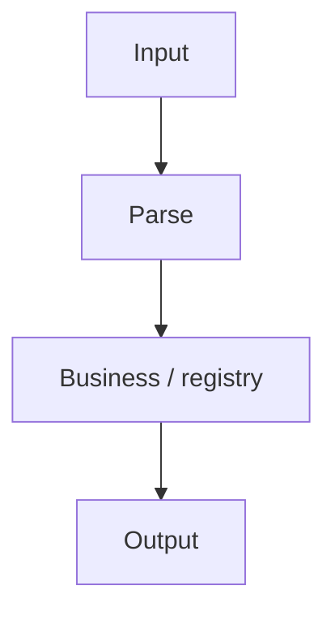

# emvparse design

Architecture and module overview (English). Extended narrative, diagrams, and examples: [../zh/设计文档.md](../zh/设计文档.md).

## 1. TLV overview

The library implements **BER-TLV** as used in EMV:

- **Tag** — one or more bytes (EMV multi-byte rules: low 5 bits `0x1F` continues).
- **Length** — short form (single byte 0–127) and BER-TLV long form (multi-byte length), per `TLVParser::readTlvLength`.
- **Value** — raw bytes or nested TLV when the tag is **constructed** (first tag byte bit 6 = 1).

Dependencies: C++14, nlohmann/json. No Qt.

## 2. Architecture

Layered responsibilities:

| Layer | Components | Role |
|-------|------------|------|
| Data | `TLV` | Tag, value, children; no business logic |
| Parse (internal) | `TLVParser` | Bytes/hex → `TLV` tree (BER-TLV only) |
| Facade | `EmvInputParser` | Tag + APDU registries; parse / script / tag-info (CLI parity) |
| Registry | `TagRegistry` (internal) | Load manifest + JSON overlays |
| Semantics | `ValueSemanticParser`, `TLVFormatter` (internal) | Map value bytes to JSON fields |
| Registry ops (source tree) | `src/tlv/tag_registry_ops.h` | Validate/merge; used by CLI, not installed |



Data flow:

```
hex + ParseOutputOptions → EmvInputParser::parseHexWithOptions / parseHexToJson
                ↓
         classify (TLV / C-APDU / R-APDU) + ApduParser
                ↓
         TagRegistry + TLVParser (nested bodies)
```

## 3. Public API surface

Installed headers (`cmake --install`, parse-only package):

| Header | Content |
|--------|---------|
| `input_parser.h` | `EmvInputParser` |
| `logging.h` | `LogLevel`, `LogCallback` |
| `output_options.h` | `ParseOutputOptions`, formats |
| `tlv.h` | Read-only `TLV` tree |
| `emvparse_global.h` | `EMVPARSE_EXPORT` (ABI only; included by the headers above—not part of the application API) |

Applications should `#include` only the first three headers. `emvparse_global.h` must remain on the install path so those headers compile when linking against the shared library (especially on Windows).

Not installed: everything under `src/` (`tlv_parser.h`, `tag_registry_ops.h`, `TagRegistry`, `TLVFormatter`, …). Build from source or link the CLI to use registry validate/merge.

Applications should use `EmvInputParser` + `ParseOutputOptions` only.

## 4. EmvInputParser (facade)

- Pimpl hides `TLVParser` and `ApduRegistry`.
- `loadRegistry` loads tag rules and APDU commands/status words.
- `parseHexWithOptions` mirrors `emvparse parse`; `parseScriptFile` / `parseScriptJson` mirror `emvparse script`.
- `parseHex`, `parseHexToJson`, `getTagInfo`, and `hexToBytes` cover BER-TLV and registry lookup without exposing internal parsers.

## 4.1 TLVParser (internal)

- Parses top-level TLV sequence from buffer or hex string (whitespace allowed in hex).
- **Constructed tags**: recursion based on tag encoding only (EMV bit 6), not registry.
- Used by the facade and unit tests that include `tlv_parser.h` via the `src/` private include path.

## 5. Tag registry

Files live in `registry/` (installed to `share/emvparse/tag-registry/`).

`manifest.json` defines `base` (`emv.json`) and per-scheme overlays (`Visa` → `visa.json`, etc.). Later files override the same tag hex.

Ambiguity (`variants[]`, overlays) is documented in [tag-registry-data-model.md](tag-registry-data-model.md). Runtime flat map uses the **first** variant when multiple exist.

## 6. CLI

Sources in `cli/`; binary name `emvparse`. Resolves manifest via `--manifest`, `EMVPARSE_REGISTRY`, install-relative paths, and source-tree fallback.

Subcommands: `parse`, `tag-info`, `registry validate|merge`.

## 7. Build layout

```
include/emvparse/   # public headers
src/tlv/            # BER-TLV, tag registry, semantics, TLV formatting
src/apdu/           # APDU registry, C/R-APDU, DOL, transaction script
src/facade/         # EmvInputParser, output pipeline, logging
cli/                # command-line tool
test/               # gtest
registry/           # manifest, overlay JSON, tag-registry.schema.json (schema not installed)
```

Shared library `EmvParse`, output name `emvparse`. Tests: `emvparse_tests`.

## 8. Related documents

- [user-guide.md](user-guide.md) — build and API usage
- [tag-registry-data-model.md](tag-registry-data-model.md) — JSON contract
- [../zh/设计文档.md](../zh/设计文档.md) — BER-TLV encoding (Chinese, §1.2)
