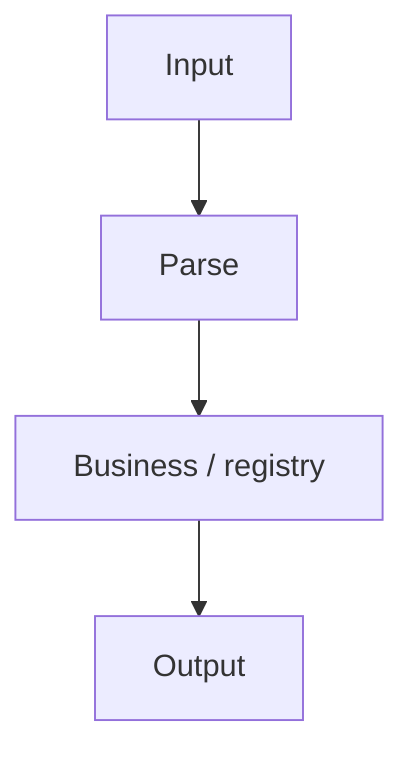

# emvparse design

Architecture and module overview (English). Extended narrative, diagrams, and examples: [../zh/设计文档.md](../zh/设计文档.md).

## 1. TLV overview

The library implements **BER-TLV** as used in EMV:

- **Tag** — one or more bytes (EMV multi-byte rules: low 5 bits `0x1F` continues).
- **Length** — currently **short form** only (single byte, 0–127).
- **Value** — raw bytes or nested TLV when the tag is **constructed** (first tag byte bit 6 = 1).

Dependencies: C++11, nlohmann/json. No Qt.

## 2. Architecture

Layered responsibilities:

| Layer | Components | Role |
|-------|------------|------|
| Data | `TLV` | Tag, value, children; no business logic |
| Parse | `TLVParser` | Bytes/hex → `TLV` tree |
| Registry | `TagRegistry` (internal) | Load manifest + JSON overlays |
| Semantics | `ValueSemanticParser`, `TLVFormatter` (internal) | Map value bytes to JSON fields |
| Public ops | `tag_registry_ops` | Validate/merge registry files |



Data flow:

```
hex / bytes → TLVParser → TLV tree
                ↓
         TagRegistry (scheme)
                ↓
         TLVFormatter → JSON (parseHexToJson)
```

## 3. Public API surface

Installed headers under `include/emvparse/`:

| Header | Content |
|--------|---------|
| `tlv_parser.h` | `TLVParser` |
| `tlv.h` | `TLV` |
| `logging.h` | `LogCallback`, `LogLevel` |
| `tag_registry_ops.h` | Registry validate/merge |
| `emvparse_global.h` | `EMVPARSE_EXPORT` |

Internal (under `src/`, not installed): `TagRegistry`, `TagInfo`, `TLVFormatter`, `ValueSemanticParser`, `Logger`.

Applications should use `TLVParser` and optionally `tag_registry_ops`; do not include internal headers.

## 4. TLVParser

- Parses top-level TLV sequence from buffer or hex string (whitespace allowed in hex).
- **Constructed tags**: recursion based on tag encoding only (EMV bit 6), not registry.
- **Registry**: constructor or `loadTagRegistry(manifestPath, scheme)` loads merged tags for semantic JSON and `getTagInfo`.
- Move-only; not copyable.

## 5. Tag registry

Files live in `registry/` (installed to `share/emvparse/tag-registry/`).

`manifest.json` defines `base` (`emv.json`) and per-scheme overlays (`Visa` → `visa.json`, etc.). Later files override the same tag hex.

Ambiguity (`variants[]`, overlays) is documented in [tag-registry-data-model.md](tag-registry-data-model.md). Runtime flat map uses the **first** variant when multiple exist.

## 6. CLI

Sources in `cli/`; binary name `emvparse`. Resolves manifest via `--manifest`, `EMVPARSE_REGISTRY`, install-relative paths, and source-tree fallback.

Subcommands: `parse`, `tag-info`, `registry validate|merge`.

## 7. Build layout

```
include/emvparse/   # public headers
src/                # library implementation
cli/                # command-line tool
test/               # gtest
registry/           # manifest, overlay JSON, tag-registry.schema.json (schema not installed)
```

Shared library `EmvParse`, output name `emvparse`. Tests: `emvparse_tests`.

## 8. Related documents

- [user-guide.md](user-guide.md) — build and API usage
- [tag-registry-data-model.md](tag-registry-data-model.md) — JSON contract
- [../zh/设计文档.md](../zh/设计文档.md) — BER-TLV encoding (Chinese, §1.2)
