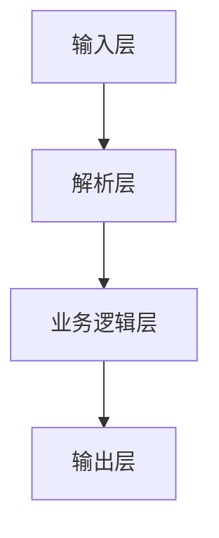

# TLV 数据解析库设计文档

## 目录

1. [TLV 数据格式概述](#1-tlv-数据格式概述)
2. [架构设计](#2-架构设计)
3. [核心模块设计](#3-核心模块设计)
4. [数据映射规则](#4-数据映射规则)
5. [使用示例](#5-使用示例)
6. [扩展功能](#6-扩展功能)

---

## 1. TLV 数据格式概述

### 依赖说明

本库使用以下依赖：
- **nlohmann/json**：用于 JSON 文件的读取和生成（header-only 库，自动下载）
- **标准 C++14**：无其他外部依赖

> **注意**：本库已移除对 Qt 的依赖，使用纯 C++ 实现，便于集成到各种项目中。

### 1.1 什么是 TLV

**TLV**（Type-Length-Value）是一种数据编码格式，广泛应用于金融支付、通信协议等领域。其名称来源于三个组成部分：

### 1.1.1 依赖说明

本库使用以下依赖：
- **nlohmann/json**：用于 JSON 文件的读取和生成（header-only 库，自动下载）
- **标准 C++14**：无其他外部依赖

> **注意**：本库已移除对 Qt 的依赖，使用纯 C++ 实现，便于集成到各种项目中。

- **T (Type/Tag)**：标识数据的类型或标签，用于区分不同的数据字段
- **L (Length)**：表示 Value 部分的字节长度
- **V (Value)**：实际的数据内容

### 1.2 TLV 编码规范

本库实现的是 **BER-TLV**（Basic Encoding Rules TLV）编码规范，这是 ISO/IEC 7816 和 EMV 标准中使用的编码方式。

#### 1.2.1 Tag 编码规则

Tag 字段可以是 **1 个字节**或 **多个字节**，遵循以下判断规则：

**第一步：读取第一个字节（必读）**
- 如果第一个字节的 **b5-b1 位（低 5 位）** ≠ `0x1F`（即 `11111`），则 Tag 为**单字节**
- 如果第一个字节的 **b5-b1 位（低 5 位）** = `0x1F`（即 `11111`），则 Tag 为**多字节**，需要继续读取后续字节

**第二步：对于多字节 Tag，读取后续字节**
- 从第二个字节开始，每个字节检查最高位（b8）：
  - 如果 **b8 = 1**：表示还有后续字节，继续读取下一个字节
  - 如果 **b8 = 0**：表示这是最后一个标签字节，停止读取

**示例：**
- **单字节 Tag**：`0x95`（低5位 = 0x15 ≠ 0x1F）、`0x6F`（低5位 = 0x0F ≠ 0x1F）
- **双字节 Tag**：`0x9F33`（第一个字节低5位 = 0x1F，第二个字节 b8=0）
- **三字节 Tag**：`0xDF 81 20`（第一个字节低5位 = 0x1F，第二个字节 b8=1，第三个字节 b8=0）

Tag 的分类：
- **单个标签**：Tag 的 bit 6 = 0，表示原始数据
- **复合标签**：Tag 的 bit 6 = 1，表示 Value 中包含嵌套的 TLV 结构

#### 1.2.2 Length 编码规则

Length 字段表示 Value 的字节数，支持以下格式：

- **短格式**：1 字节，范围 0x00-0x7F（0-127 字节）
- **长格式**：首字节高 7 位表示后续字节数，范围 0x81-0xFE（128-254 字节）

> **注意**：当前实现仅支持短格式（单字节 Length），长格式将在后续版本中支持。

#### 1.2.3 Value 编码规则

Value 字段包含实际数据，可以是：
- 原始二进制数据
- 嵌套的 TLV 结构（当 Tag 为复合标签时）
- 各种编码格式（BCD、ASCII、UTF-8 等）

### 1.3 应用场景

- **金融支付**：EMV 卡交易数据、POS 终端通信
- **通信协议**：NFC、蓝牙、智能卡通信
- **数据存储**：配置文件、数据库记录
- **编码格式**：ASN.1、BER、DER 编码

---

## 2. 架构设计

### 2.1 设计原则

本库采用 **分层架构 + 职责分离** 的设计原则：

1. **数据层**：纯数据结构，不包含业务逻辑
2. **解析层**：负责 TLV 格式的解析，不关心业务含义
3. **业务层**：负责业务规则映射和数据格式化
4. **输出层**：负责多种格式的输出



### 2.2 架构图

```
┌─────────────────────────────────────────────────────────┐
│                     应用层 (Application)                  │
│  ┌──────────────┐  ┌──────────────┐  ┌──────────────┐  │
│  │ TLVFormatter │  │ TLVValidator │  │ 自定义处理   │  │
│  └──────────────┘  └──────────────┘  └──────────────┘  │
└─────────────────────────────────────────────────────────┘
                          ↓
┌─────────────────────────────────────────────────────────┐
│                     业务层 (Business)                    │
│  ┌──────────────────────────────────────────────────┐  │
│  │           TagRegistry (Tag 规则库)               │  │
│  │  - 加载 Tag 定义 (JSON)                           │  │
│  │  - 查询 Tag 元信息                                │  │
│  │  - 支持多协议 (EMV/GP/自定义)                     │  │
│  └──────────────────────────────────────────────────┘  │
│  ┌──────────────────────────────────────────────────┐  │
│  │              TagInfo (Tag 元信息)                  │  │
│  │  - 数据类型 (NUMERIC/TEXT/DATE/BITFIELD/ENUM等)    │  │
│  │  - 格式规则 (BCD/ASCII/ISO 3166-1等)              │  │
│  │  - BitField 规则 (位字段解析)                      │  │
│  └──────────────────────────────────────────────────┘  │
└─────────────────────────────────────────────────────────┘
                          ↓
┌─────────────────────────────────────────────────────────┐
│                     解析层 (Parsing)                     │
│  ┌──────────────────────────────────────────────────┐  │
│  │  EmvInputParser (门面)  │  TLVParser (BER-TLV)     │  │
│  │  - parseHexWithOptions  │  - parseBytes/parseHex   │  │
│  │  - Tag + APDU registry  │  - 递归嵌套 TLV          │  │
│  └──────────────────────────────────────────────────┘  │
└─────────────────────────────────────────────────────────┘
                          ↓
┌─────────────────────────────────────────────────────────┐
│                     数据层 (Data)                        │
│  ┌──────────────────────────────────────────────────┐  │
│  │              TLV (基础数据结构)                   │  │
│  │  - Tag (字节数组)                                 │  │
│  │  - Value (字节数组)                               │  │
│  │  - Children (嵌套 TLV 列表)                       │  │
│  └──────────────────────────────────────────────────┘  │
└─────────────────────────────────────────────────────────┘
```

### 2.3 数据流

```
输入数据 (字节流/Hex字符串)
    ↓
TLVParser::parse() / parseHex()
    ↓
TLV 对象 (纯数据，无业务含义)
    ↓
TagRegistry::getTagInfo() (查询业务规则)
    ↓
TagInfo (业务规则)
    ↓
根据 TagInfo.type 和 format 解析 Value
    ↓
格式化输出 (JSON/表格/自定义报告)
```

---

## 3. 核心模块设计

### 3.1 TLV 类（数据层）

`TLV` 类表示一个 TLV 结构，**仅存储原始数据，不包含任何业务逻辑**。

#### 3.1.1 设计原则

- **纯数据容器**：只负责存储 Tag、Length、Value
- **不可变性**：创建后数据不可修改（通过 const 方法访问）
- **嵌套支持**：通过 `children` 字段支持嵌套 TLV

#### 3.1.2 类定义

```cpp
class TLV {
public:
    using ByteArray = std::vector<uint8_t>;
    using Children = std::vector<std::shared_ptr<TLV>>;

    // 构造函数
    TLV(const ByteArray& tag, const ByteArray& value);

    // 数据访问（只读）
    const ByteArray& getTag() const;
    const ByteArray& getValue() const;
    const Children& getChildren() const;

    // 工具方法
    std::string tagHex() const;    // Tag 的 Hex 字符串（如 "9F33"）
    std::string valueHex() const;  // Value 的 Hex 字符串
};
```

#### 3.1.3 设计说明

- `TLV` 是"数据"，`TagInfo` 是"数据的说明书"
- `TLV` 不关心业务含义，只负责存储和格式化输出
- 嵌套解析由 `TLVParser` 负责，`TLV` 只存储结果

### 3.2 TLVParser 类（解析层，库内实现）

`TLVParser` 负责将原始数据解析为 `TLV` 对象；对外请使用 `EmvInputParser`（Pimpl 门面），头文件位于 `src/`，不 install。

#### 3.2.1 设计原则

- **单一职责**：只负责 TLV 格式解析
- **依赖注入**：通过构造函数注入 `TagRegistry`，便于测试和扩展
- **递归解析**：自动处理嵌套 TLV 结构

#### 3.2.2 类定义

```cpp
class TLVParser {
public:
    // 构造函数
    TLVParser();
    explicit TLVParser(const std::string& tagRegistryJsonPath);

    // 解析接口（公共 API）
    std::vector<std::shared_ptr<TLV>> parse(const std::vector<uint8_t>& data);
    std::vector<std::shared_ptr<TLV>> parseHex(const std::string& hexStr);

private:
    // 内部解析方法：自动处理嵌套结构
    // 如果 TLV 的 Tag 被标记为 COMPOSITE 类型，会自动递归解析其 Value 中的子 TLV
    std::shared_ptr<TLV> parseTLV(const std::vector<uint8_t>& data, size_t& offset);
    bool isTwoByteTag(uint8_t firstByte);
};
```

#### 3.2.3 解析流程

1. **解析 Tag**：根据第一个字节判断是单字节还是双字节 Tag
2. **解析 Length**：读取 Length 字节（当前仅支持单字节）
3. **解析 Value**：根据 Length 读取 Value 字节
4. **自动检查嵌套**：根据 **EMV 标准**，检查 Tag 第一个字节的 **bit 6（构造位）**
   - **bit 6 = 1**：复合标签，自动递归解析 Value 中的子 TLV
   - **bit 6 = 0**：基本标签，Value 是原始数据
   - 嵌套处理完全在 `parseTLV` 内部完成，用户无需关心
   - 解析结果存储在 `TLV::children` 中
   - **无需依赖 TagRegistry**：判断基于 Tag 本身的编码，符合 EMV 标准

> **详细说明**：见本文 [§1.2 TLV 编码规范](#12-tlv-编码规范)。

### 3.3 TagInfo 类（业务规则）

`TagInfo` 描述 Tag 的业务含义和解析规则。

#### 3.3.1 类定义

```cpp
class TagInfo {
public:
    std::string tag;       // Tag 的16进制表示（如 "9F33"）
    std::string name;         // 名称（如 "Terminal Country Code"）
    std::string type;         // 数据类型（见下文）
    std::string format;       // 格式规则（如 "n", "cn", "ans"）
    std::string length;       // 预期长度（如 "6", "2-10", "var"）
    std::string kernel;       // 内核类型（"EMV", "Visa", "Mastercard"等）
    std::string source;       // 数据来源（"ICC" 或 "Terminal"）
    std::string note;         // 备注信息
    std::vector<BitFieldRule> bitFields; // Bit 字段规则（当 type="BITFIELD" 时使用）
    std::map<std::string, std::string> enumMap; // 枚举映射表（当 type="ENUM" 时使用）

    // 静态方法：解析 Bit 字段
    static std::map<std::string, std::string> parseBitField(
        uint8_t valueByte,
        const std::vector<BitFieldRule>& rules
    );
};
```

#### 3.3.2 数据类型（type 字段）

`type` 字段表示数据的**业务类型**或**语义类别**，用于标识 Tag 在业务逻辑中的用途。

| 数据类型 | 说明 | 示例场景 | Value 示例（Hex） | 解析结果 |
|---------|------|---------|------------------|---------|
| `NUMERIC` | 数值类型（整数/小数） | 交易金额、国家代码（ISO 3166-1 数字）、计数器、版本号 | `01 41`（BCD） | `141`（十进制） |
| `TEXT` | 文本类型 | 商户名称、持卡人姓名、应用标识符（AID） | `42 6F 62` | `"Bob"` |
| `DATE` | 日期或时间 | 交易日期、卡片有效期、交易时间戳 | `23 10 01`（BCD） | `"2023-10-01"` |
| `BITFIELD` | 位字段类型 | 交易标志位、状态码、配置选项 | `D0`（二进制） | 多个字段的映射 |
| `ENUM` | 枚举类型 | 国家代码、货币代码、状态码、交易类型 | `01 56`（BCD） | `"156"` → `"中国"`（需映射表） |
| `N/A` | 二进制数据或未知类型 | 证书数据、密钥数据、加密数据、未知 Tag | `A1 B2 C3 D4` | 返回原始十六进制值 |

**类型覆盖说明**：

这 5 个 type 基本可以覆盖所有 EMV tag 的业务含义：

1. **数值类数据**：使用 `NUMERIC` 类型
   - 交易金额、计数器、版本号、长度等
   - 支持 BCD 编码（`n`）和压缩数字（`cn`）

2. **文本类数据**：使用 `TEXT` 类型
   - 商户名称、持卡人姓名、应用标识符（AID）等
   - 支持字母（`a`）、字母数字（`an`）、字母数字特殊字符（`ans`）

3. **日期时间类数据**：使用 `DATE` 类型
   - 交易日期、卡片有效期、时间戳等
   - 根据数据长度自动识别格式（YYMMDD、YYMMDDHHMMSS 等）

4. **标志位/状态类数据**：使用 `BITFIELD` 类型
   - 交易标志位、状态码、配置选项等
   - 支持位级别的字段解析和映射

5. **枚举类数据**：使用 `ENUM` 类型
   - 国家代码、货币代码、状态码、交易类型等
   - 需要提供 `enumMap` 映射表

6. **二进制/未知数据**：不定义 `type`（或 `type` 为空）
   - 证书数据、密钥数据、加密数据、未知 Tag 等
   - 系统自动返回原始十六进制值，不进行语义解析

7. **复合标签（嵌套 TLV）**：无需定义 `type`
   - 通过 EMV 标准的 bit 6 自动识别
   - 系统自动递归解析嵌套的 TLV 结构

#### 3.3.3 格式规则（format 字段）

`format` 字段表示数据的**编码方式**或**表示形式**，用于指定 Value 的解析方法。本库**优先支持 EMV 标准格式**（符合 EMV Book 3.0），同时兼容扩展格式。

##### EMV 标准格式（优先使用）

| 格式 | 说明 | 适用 type | 示例 | EMV 标准 |
|------|------|----------|------|---------|
| `n` | Numeric（数字，BCD 编码，右对齐，前导零填充） | `NUMERIC` | `00 00 00 01 23 45` → `12345` | EMV Book 3.0 |
| `cn` | Compressed Numeric（压缩数字，左对齐，尾部填充F） | `NUMERIC` | `12 34 56 78 90 12 3F FF` → `1234567890123` | EMV Book 3.0 |
| `a` | Alphabetic（字母，a-z, A-Z） | `TEXT` | `42 6F 62` → `"Bob"` | EMV Book 3.0 |
| `an` | Alphanumeric（字母数字，a-z, A-Z, 0-9） | `TEXT` | `41 42 43 31 32 33` → `"ABC123"` | EMV Book 3.0 |
| `ans` | Alphanumeric Special（字母数字特殊字符） | `TEXT` | （包含特殊字符） | EMV Book 3.0 |
| `b` | Binary（二进制数据或位组合） | `N/A` | `A1 B2 C3 D4` → （原始字节） | EMV Book 3.0 |
| `var.` | Variable（可变长度，任意位组合） | `N/A` | （可变长度） | EMV Book 3.0 |

**格式映射关系**：

- **`b`**（EMV 标准）→ **`N/A`**：二进制数据不定义 `type`（或 `type` 为空），系统自动返回原始十六进制值

**推荐使用**：使用 EMV 标准格式（`n`, `cn`, `a`, `an`, `ans`, `b`），以保持与 EMV 标准的一致性。

**DATE 类型的自动格式识别**：

当 `type="DATE"` 时，系统会根据 Value 的数据长度自动识别格式，无需指定 `format` 字段：

| 数据长度 | 自动识别格式 | 示例 | 解析结果 |
|---------|------------|------|---------|
| 2 字节 | MMDD（月日，BCD格式） | `10 01` | `"MM-DD: 10-01"` |
| 3 字节 | YYMMDD（年月日） | `23 10 01` | `"2023-10-01"` |
| 4 字节 | YYMMDDHH（年月日时） | `23 10 01 14` | `"2023-10-01 14:00:00"` |
| 6 字节 | YYMMDDHHMMSS（年月日时分秒，BCD格式） | `23 10 01 14 30 00` | `"2023-10-01 14:30:00"` |

#### 3.3.4 其他字段

除了 `type` 和 `format` 字段外，`TagInfo` 还支持以下可选字段：

| 字段 | 说明 | 可选值 | 示例 |
|------|------|--------|------|
| `length` | 预期长度 | 固定长度（如 `"6"`）、范围（如 `"2-10"`）、可变长度（如 `"var"`） | `"6"`, `"2-10"`, `"var"` |
| `kernel` | 内核类型 | `"EMV"`, `"Visa"`, `"Mastercard"` 等 | `"EMV"` |
| `source` | 数据来源 | `"ICC"`（卡片）, `"Terminal"`（终端） | `"ICC"` |
| `note` | 备注信息 | 任意字符串 | `"交易授权金额，BCD编码"` |

这些字段用于描述 Tag 的元信息，在 JSON 输出中会包含这些信息（如果已定义）。

**`type` 和 `format` 的区别**：

- **`type`**：描述数据的**业务含义**和**语义类别**（如：国家代码、交易金额、日期等）
- **`format`**：描述数据的**编码方式**和**解析方法**（如：`n`、`cn`、`a`、`an`、`ans`、`b` 等 EMV 标准格式）

**示例对比**：

```json
// 示例1：交易金额（数值类型，BCD编码）
{
  "tag": "9F02",
  "name": "Amount, Authorised (Numeric)",
  "type": "NUMERIC",      // 业务类型：数值
  "format": "n"           // 编码格式：EMV标准格式 n（Numeric，BCD编码，右对齐，前导零填充）
}

// 示例2：持卡人姓名（文本类型，字母数字特殊字符）
{
  "tag": "5F20",
  "name": "Cardholder Name",
  "type": "TEXT",         // 业务类型：文本
  "format": "ans"         // 编码格式：EMV标准格式 ans（Alphanumeric Special，字母数字特殊字符）
}

// 示例3：国家代码（数值类型，BCD编码）
{
  "tag": "9F33",
  "name": "Terminal Country Code",
  "type": "NUMERIC",      // 业务类型：数值（或可用 ENUM）
  "format": "n"           // 编码格式：EMV标准格式 n（Numeric，BCD编码，ISO 3166-1数字代码）
  // 注意：如果需要将数字代码映射为国家名称，建议使用 ENUM 类型
}
```

#### 3.3.5 国家代码的处理方式

对于**国家代码**这类场景（不同 Value 值对应不同的国家），有两种处理方式：

**方式1：使用 `NUMERIC` + `n`（当前实现）**

```json
{
  "tag": "9F33",
  "name": "Terminal Country Code",
  "type": "NUMERIC",
  "format": "n"
}
```

- **优点**：简单直接，解析为数字代码（如 `156` 表示中国）
- **缺点**：需要外部映射表将数字代码转换为国家名称
- **适用场景**：只需要数字代码，不需要国家名称映射

**方式2：使用 `ENUM` 类型（推荐，需要扩展实现）**

```json
{
  "tag": "9F33",
  "name": "Terminal Country Code",
  "type": "ENUM",
  "format": "n",
  "enumMap": {
    "156": "中国 (China)",
    "840": "美国 (United States)",
    "826": "英国 (United Kingdom)",
    "276": "德国 (Germany)"
  }
}
```

- **优点**：可以直接将数字代码映射为国家名称，语义更清晰
- **缺点**：需要维护枚举映射表
- **适用场景**：需要将代码转换为可读的国家名称

> **注意**：当前实现中，`ENUM` 类型主要用于 `BITFIELD` 的 `BitFieldRule` 中。如果需要支持 Tag 级别的枚举映射，需要扩展 `ValueSemanticParser` 的实现。

### 3.4 TagRegistry 类（业务规则库）

`TagRegistry` 管理所有 Tag 的业务规则，通过 **manifest + scheme** 合并加载 `registry/` 下的分层 JSON（见 [标签注册表数据模型.md](标签注册表数据模型.md)）。

#### 3.4.1 类定义

```cpp
class TagRegistry {
public:
    bool loadManifest(const std::string& manifestPath, const std::string& scheme);

    std::shared_ptr<TagInfo> getTagInfo(const std::string& tagHex) const;
};
```

> **注意**：合并顺序由 `manifest.json` 的 `base` 与 `overlays[scheme]` 决定；同 tag 以后加载文件为准，并写 INFO 日志。

#### 3.4.2 JSON 格式示例

```json
[
  {
    "tag": "9F33",
    "name": "Terminal Country Code",
    "type": "NUMERIC",
    "format": "n"
  },
  {
    "tag": "9F6B",
    "name": "Transaction Flags",
    "type": "BITFIELD",
    "bitFields": [
      {
        "position": 7,
        "length": 1,
        "name": "ElectronicCashSupported",
        "type": "ENUM",
        "enumMap": {
          "0": "false",
          "1": "true"
        }
      },
      {
        "position": 4,
        "length": 3,
        "name": "ErrorCode",
        "type": "ENUM",
        "enumMap": {
          "0": "NoError",
          "1": "LowBattery",
          "2": "NetworkError"
        }
      }
    ]
  }
]
```

### 3.5 TLVFormatter 类（输出层）

`TLVFormatter` 负责将 TLV 对象格式化为各种输出格式。

#### 3.5.1 类定义

```cpp
class TLVFormatter {
public:
    // 将 TLV 转换为 JSON 对象（使用 nlohmann/json）
    static nlohmann::json toJson(const std::shared_ptr<TLV>& tlv);

    // 将 TLV 列表转换为表格字符串（CSV 格式）
    static std::string toTable(const std::vector<std::shared_ptr<TLV>>& tlvList);

    // 自定义格式化输出
    static std::string toCustomReport(const std::shared_ptr<TLV>& tlv);
};
```

> **注意**：本库使用 **nlohmann/json** 进行 JSON 处理，这是一个纯 C++ 的 header-only 库，无需额外依赖。

---

## 4. 数据映射规则

### 4.1 type 和 format 的配合使用

在实际使用中，`type` 和 `format` 需要配合使用：

| 业务场景 | type | format | 说明 | EMV 标准 |
|---------|------|--------|------|---------|
| 交易金额 | `NUMERIC` | `n` | 数值类型，BCD编码（右对齐，前导零） | ✅ EMV Book 3.0 |
| 持卡人姓名 | `TEXT` | `ans` | 文本类型，字母数字特殊字符 | ✅ EMV Book 3.0 |
| PAN（主账号） | `NUMERIC` | `cn` | 压缩数字，左对齐，尾部F填充 | ✅ EMV Book 3.0 |
| 交易日期 | `DATE` | （自动识别） | 日期类型，根据数据长度自动识别格式 | （自动处理） |
| 国家代码 | `NUMERIC` | `n` | 数值类型，BCD编码（ISO 3166-1数字代码） | ✅ EMV Book 3.0 |
| 国家代码（带映射） | `ENUM` | `n` | 枚举类型，BCD编码，需要enumMap映射表 | ✅ EMV Book 3.0 |
| 应用密码 | `N/A` | `b` | 二进制数据，返回原始值 | ✅ EMV Book 3.0 |
| 交易标志位 | `BITFIELD` | `b` | 位字段类型，使用bitFields规则 | ✅ EMV Book 3.0 |

### 4.2 BitField 类型详解

BitField 类型用于处理位字段数据，支持单字节和多字节数据。每个位字段可以独立解析，支持跨字节的位字段提取。

#### 4.2.1 BitFieldRule 结构

```cpp
struct BitFieldRule {
    int position;  // 起始 bit 位置（从 0 开始，相对于整个数据块，从第一个字节的最高位开始）
    int length;    // 占用的 bit 长度
    std::string type; // "NUMERIC", "ENUM"
    std::map<std::string, std::string> enumMap; // 枚举映射表（仅 type="ENUM" 时使用）
};
```

**说明：**
- `position` 和 `length` 的组合足以唯一标识一个位字段规则
- 不需要 `name` 字段，因为位置信息已经足够表示唯一性
- 在 JSON 输出中，使用 `range`（格式：`"起始位-结束位"`）作为键来标识每个位字段

**重要说明：**
- `position` 是相对于整个数据块的位位置，不是相对于单个字节
- 位位置从 0 开始，从第一个字节的最高位（bit 7）开始计数
- 例如：3 字节数据，position=0 是第一个字节的最高位，position=23 是第三个字节的最高位
- 支持跨多个字节的位字段提取

#### 4.2.2 解析逻辑

**单字节示例：**
```cpp
// 示例：解析 0xD0 (二进制 11010000)
// position=7, length=1 → bit 7 = 1 → "ElectronicCashSupported" = true
// position=4, length=3 → bits 4-6 = 101 → "ErrorCode" = 5
// position=0, length=4 → bits 0-3 = 0000 → "SubStatus" = 0
```

**多字节示例：**
```cpp
// 示例：解析 3 字节数据 [0xA1, 0xB2, 0xC3]
// position=0, length=1 → 第一个字节的 bit 7 = 1
// position=8, length=4 → 第二个字节的 bit 7-4 = 1011
// position=16, length=8 → 第三个字节的所有位 = 11000011
```

#### 4.2.3 使用场景

- **交易标志位**：一个或多个字节包含多个布尔标志
- **状态码**：多个状态字段组合在一个或多个字节中
- **配置选项**：多个配置项打包在一个或多个字节中
- **多字节位字段**：支持跨字节的位字段提取，适用于复杂的位字段结构

#### 4.1.4 BITFIELD 类型语义解析结果字段

BITFIELD 类型的语义解析结果包含以下字段：

| 字段名 | 类型 | 说明 | 示例 |
|--------|------|------|------|
| `bitFields` | Array | 包含所有位字段的解析结果，每个元素是一个包含位置、值、含义等信息的对象 | 见下方示例 |
| `raw` | String | Value 的原始十六进制字符串（始终包含） | `"D0"` |

**`bitFields` 数组中每个元素的结构：**

每个位字段是一个对象，包含以下字段：

| 字段名 | 类型 | 说明 | 示例 |
|--------|------|------|------|
| `position` | Number | 起始位位置（从 0 开始，相对于整个数据块） | `7` |
| `length` | Number | 占用的位数 | `1` |
| `range` | String | 位范围（格式：`"起始位-结束位"`） | `"7-7"` |
| `value` | String | 解析后的值（字符串形式） | `"true"` 或 `"5"` |
| `rawValue` | Number | 提取的原始位值（数字形式） | `1` 或 `5` |
| `meaning` | String | 值的含义说明 | `"true"` 或 `"NoError"` 或 `"5"` |

**示例 JSON 输出：**

```json
{
  "tag": "9F6B",
  "length": "0x01",
  "value": "D0",
  "name": "Terminal Capabilities",
  "type": "BITFIELD",
  "semantic": {
    "bitFields": [
      {
        "position": 7,
        "length": 1,
        "range": "7-7",
        "value": "true",
        "rawValue": 1,
        "meaning": "true"
      },
      {
        "position": 6,
        "length": 1,
        "range": "6-6",
        "value": "true",
        "rawValue": 1,
        "meaning": "true"
      },
      {
        "position": 5,
        "length": 1,
        "range": "5-5",
        "value": "false",
        "rawValue": 0,
        "meaning": "false"
      },
      {
        "position": 4,
        "length": 1,
        "range": "4-4",
        "value": "true",
        "rawValue": 1,
        "meaning": "true"
      }
    ],
    "raw": "D0"
  }
}
```

**字段解析说明：**

1. **数组结构**：
   - `bitFields` 是一个数组，每个元素是一个位字段对象
   - 数组顺序与 `BitFieldRule` 在 `registry/` 中的定义顺序一致
   - 不需要使用键来标识，因为数组本身有序

2. **位置信息**：
   - `position`：起始位位置（从 0 开始，从第一个字节的最高位开始）
   - `length`：占用的位数
   - `range`：位范围字符串，格式为 `"起始位-结束位"`

3. **值信息**：
   - `value`：解析后的值（字符串形式），根据 `BitFieldRule.type` 解析：
     - `NUMERIC`：数字字符串（如 `"5"`）
     - `ENUM`：枚举值字符串（如 `"NoError"`、`"true"`、`"false"`）
   - `rawValue`：提取的原始位值（数字形式），便于程序处理

4. **含义说明**：
   - `meaning`：值的含义说明
     - `NUMERIC` 类型：含义就是值本身（数字字符串）
     - `ENUM` 类型：从 `enumMap` 中查找的枚举含义，如果未找到则返回 `"UNKNOWN"`
     - **注意**：布尔值可以用 `ENUM` 类型实现，在 `enumMap` 中定义 `"0": "false"` 和 `"1": "true"`

**解析格式说明：**

在解析某个 Value 时，可以按照以下格式阐述：

> **位置 `range` 相应的值 `value`，值表示的含义：`meaning`**

例如：
- **位置 7-7 相应的值 true，值表示的含义：true**
- **位置 4-6 相应的值 5，值表示的含义：NetworkError**

**说明：**
- `position` 是相对于整个数据块的位位置（从 0 开始，从第一个字节的最高位开始）
- 支持多字节 BITFIELD 数据，可以跨字节提取位字段
- `range` 字段便于理解位字段的覆盖范围

### 4.2 语义解析输出字段说明

语义解析（`ValueSemanticParser::parseValueSemantic`）会根据不同的数据类型返回不同的字段。所有类型都会包含 `raw` 字段（原始 HEX 值），其他字段根据类型而定。

#### 4.2.1 NUMERIC 类型

| 字段名 | 类型 | 说明 | 示例 |
|--------|------|------|------|
| `numeric` | String | 解析后的数字字符串 | `"141"` |
| `raw` | String | Value 的原始十六进制字符串 | `"0141"` |

**示例 JSON 输出：**

```json
{
  "tag": "9F33",
  "length": "0x02",
  "value": "0141",
  "type": "NUMERIC",
  "semantic": {
    "numeric": "141",
    "raw": "0141"
  }
}
```

#### 4.2.2 TEXT 类型

| 字段名 | 类型 | 说明 | 示例 |
|--------|------|------|------|
| `text` | String | 解析后的文本字符串 | `"Bob"` |
| `raw` | String | Value 的原始十六进制字符串 | `"426F62"` |

**示例 JSON 输出：**

```json
{
  "tag": "50",
  "length": "0x03",
  "value": "426F62",
  "type": "TEXT",
  "semantic": {
    "text": "Bob",
    "raw": "426F62"
  }
}
```

#### 4.2.3 DATE 类型

| 字段名 | 类型 | 说明 | 示例 |
|--------|------|------|------|
| `date` | String | 解析后的日期时间字符串 | `"2023-10-01"` 或 `"2023-10-01 14:30:00"` |
| `raw` | String | Value 的原始十六进制字符串 | `"231001"` |

**示例 JSON 输出：**

```json
{
  "tag": "9A",
  "length": "0x03",
  "value": "231001",
  "type": "DATE",
  "semantic": {
    "date": "2023-10-01",
    "raw": "231001"
  }
}
```

#### 4.2.4 ENUM 类型

| 字段名 | 类型 | 说明 | 示例 |
|--------|------|------|------|
| `code` | String | 根据 format 解析出的代码字符串（用于查找枚举值） | `"A0000006581010"` 或 `"156"` |
| `enum` | String | 在 enumMap 中查找到的可读枚举值，如果未找到则返回 `"UNKNOWN"` | `"MIR Credit (Russia)"` 或 `"UNKNOWN"` |
| `raw` | String | Value 的原始十六进制字符串 | `"A0000006581010"` |

**示例 JSON 输出：**

```json
{
  "tag": "4F",
  "length": "0x07",
  "value": "A0000006581010",
  "type": "ENUM",
  "format": "b",
  "semantic": {
    "code": "A0000006581010",
    "enum": "MIR Credit (Russia)",
    "raw": "A0000006581010"
  }
}
```

**说明：**
- `code` 字段的值根据 `format` 解析：
  - `format == "b"`：直接使用 HEX 字符串
  - `format == "n"`：BCD 编码转数字字符串
  - `format == "cn"`：压缩数字格式
  - `format == "a"/"an"/"ans"`：文本格式
  - 其他格式：转换为大整数字符串
- `enum` 字段在 `enumMap` 中查找 `code` 对应的值
- 如果 `enumMap` 中找不到对应的映射，`enum` 返回 `"UNKNOWN"`

#### 4.2.5 布尔值处理（使用 ENUM 类型）

布尔值可以使用 `ENUM` 类型来实现，在 `enumMap` 中定义映射关系。

**JSON 配置示例：**

```json
{
  "tag": "9F7A",
  "name": "Terminal Transaction Qualifiers",
  "type": "ENUM",
  "format": "b",
  "enumMap": {
    "0": "false",
    "1": "true"
  }
}
```

**示例 JSON 输出：**

```json
{
  "tag": "9F7A",
  "length": "0x01",
  "value": "01",
  "type": "ENUM",
  "semantic": {
    "code": "1",
    "enum": "true",
    "raw": "01"
  }
}
```

**说明：**
- 布尔值可以通过 `ENUM` 类型实现，在 `enumMap` 中定义 `"0": "false"` 和 `"1": "true"`
- 这样既保持了灵活性，又统一了类型系统

#### 4.2.6 BINARY 类型或未定义类型

| 字段名 | 类型 | 说明 | 示例 |
|--------|------|------|------|
| `raw` | String | Value 的原始十六进制字符串 | `"A1B2C3D4"` |

**示例 JSON 输出：**

```json
{
  "tag": "9F10",
  "length": "0x04",
  "value": "A1B2C3D4",
  "type": "BINARY",
  "semantic": {
    "raw": "A1B2C3D4"
  }
}
```

### 4.3 格式规则（format 字段）

> **注意**：本库遵循 **EMV 标准格式**（EMV Book 3.0），format 字段应使用 EMV 标准格式（`n`, `cn`, `a`, `an`, `ans`, `b` 等），而不是自定义格式（如 BCD、ASCII、YYMMDD 等）。详细的格式说明请参考 [3.3.3 格式规则（format 字段）](#333-格式规则format-字段) 章节。

---

## 5. 使用示例

### 5.1 基本使用

```cpp
#include <emvparse/input_parser.h>
#include <iostream>

EmvInputParser parser("registry/manifest.json", "EMV");
std::cout << parser.parseHexToJson("9F33020141") << std::endl;
std::cout << parser.getTagInfo("9F33") << std::endl;
```

### 5.2 处理嵌套 TLV

```cpp
// 嵌套结构见 JSON 的 children 字段
EmvInputParser parser("registry/manifest.json", "EMV");
std::cout << parser.parseHexToJson(
    "6F1A840E315041592E5359532E4444463031A5088801025F2D02656E") << std::endl;
```

### 5.3 处理 BitField

```cpp
// 库内白盒测试：TLVParser + ValueSemanticParser（头文件在 src/，不 install）
TLVParser tlvParser;
tlvParser.loadTagRegistry("registry/manifest.json", "EMV");
auto tlv = tlvParser.parseHex("9F6B01D0")[0];
TagRegistry* registry = tlvParser.tagRegistry();
auto tagInfo = registry->getTagInfo("9F6B");
if (tagInfo && tagInfo->type == "BITFIELD") {
    auto semantic = ValueSemanticParser::parseValueSemantic(tlv, tagInfo);
    if (semantic.contains("bitFields") && semantic["bitFields"].is_array()) {
        auto bitFields = semantic["bitFields"];
        for (const auto& fieldInfo : bitFields) {
            std::string range = fieldInfo["range"];
            std::string value = fieldInfo["value"];
            std::string meaning = fieldInfo["meaning"];
            
            // 按照格式输出：位置 range 相应的值，值表示的含义
            std::cout << "位置 " << range 
                      << " 相应的值 " << value 
                      << "，值表示的含义：" << meaning << std::endl;
        }
    }
}
```

**输出示例：**

```json
{
  "tag": "9F6B",
  "length": "0x01",
  "value": "D0",
  "name": "Terminal Capabilities",
  "type": "BITFIELD",
  "semantic": {
    "bitFields": [
      {
        "position": 7,
        "length": 1,
        "range": "7-7",
        "value": "true",
        "rawValue": 1,
        "meaning": "true"
      },
      {
        "position": 6,
        "length": 1,
        "range": "6-6",
        "value": "true",
        "rawValue": 1,
        "meaning": "true"
      },
      {
        "position": 5,
        "length": 1,
        "range": "5-5",
        "value": "false",
        "rawValue": 0,
        "meaning": "false"
      },
      {
        "position": 4,
        "length": 1,
        "range": "4-4",
        "value": "true",
        "rawValue": 1,
        "meaning": "true"
      }
    ],
    "raw": "D0"
  }
}
```

**控制台输出示例：**

```
位置 7-7 相应的值 true，值表示的含义：true
位置 6-6 相应的值 true，值表示的含义：true
位置 5-5 相应的值 false，值表示的含义：false
位置 4-4 相应的值 true，值表示的含义：true
```

**`bitFields` 数组说明：**

`bitFields` 是一个数组，每个元素对应 `BitFieldRule` 中定义的一个位字段规则。每个元素是一个包含位置、值、含义等信息的对象。

以 `9F6B` 标签为例（Value = `0xD0` = 二进制 `11010000`）：

| 位置 | 长度 | 范围 | 值 | 原始值 | 含义 | 说明 |
|------|------|------|------|--------|------|------|
| 7 | 1 | 7-7 | `"true"` | 1 | `"true"` | 位置 7-7 相应的值 true，值表示的含义：true |
| 6 | 1 | 6-6 | `"true"` | 1 | `"true"` | 位置 6-6 相应的值 true，值表示的含义：true |
| 5 | 1 | 5-5 | `"false"` | 0 | `"false"` | 位置 5-5 相应的值 false，值表示的含义：false |
| 4 | 1 | 4-4 | `"true"` | 1 | `"true"` | 位置 4-4 相应的值 true，值表示的含义：true |

**字段解析过程：**

1. **数组结构**：`bitFields` 是一个数组，每个元素是一个位字段对象
   - 数组顺序与 `BitFieldRule` 在 `registry/` 中的定义顺序一致
   - 不需要使用键来标识，因为数组本身有序
   - `position` 和 `length` 的组合足以唯一标识一个位字段，不需要额外的 `name` 字段
2. **位提取**：根据 `BitFieldRule` 的 `position` 和 `length`，从 Value 数据中提取对应的位
   - `position` 是相对于整个数据块的位位置（从 0 开始，从第一个字节的最高位开始）
   - `length` 是要提取的位数
   - `range` 是位范围字符串，格式为 `"起始位-结束位"`
3. **值解析**：根据 `BitFieldRule` 的 `type` 进行解析：
   - **NUMERIC**：提取的位值转换为数字字符串（如 `"5"`），`meaning` 就是值本身
   - **ENUM**：在 `BitFieldRule.enumMap` 中查找对应的枚举值，`meaning` 是枚举含义，如果未找到则返回 `"UNKNOWN"`
   - **注意**：布尔值可以用 `ENUM` 类型实现，在 `enumMap` 中定义 `"0": "false"` 和 `"1": "true"`

**示例：解析 `0xD0` (二进制 `11010000`)**

```
位位置:  7  6  5  4  3  2  1  0
二进制:  1  1  0  1  0  0  0  0
十六进制: D  0

字段解析（根据 registry/ 中的 BitFieldRule 定义）：
- 位置 7-7 相应的值 true，值表示的含义：true
- 位置 6-6 相应的值 true，值表示的含义：true
- 位置 5-5 相应的值 false，值表示的含义：false
- 位置 4-4 相应的值 true，值表示的含义：true
```

**ENUM 类型示例：**

如果某个位字段是 ENUM 类型，且 `enumMap` 中定义了映射：

```json
{
  "ErrorCode": {
    "position": 4,
    "length": 3,
    "range": "4-6",
    "value": "5",
    "rawValue": 5,
    "meaning": "NetworkError"
  }
}
```

解析格式：**位置 4-6 ErrorCode 相应的值 5，值表示的含义：NetworkError**

> **注意**：实际的解析结果取决于 `registry/` 中定义的 `BitFieldRule` 规则。不同的标签可能有不同的位字段定义，同一个位字段在不同标签中的含义可能不同。

### 5.4 输出 JSON 格式

```cpp
#include <emvparse/input_parser.h>
#include <emvparse/output_options.h>
#include <iostream>

EmvInputParser parser("registry/manifest.json", "EMV");
std::cout << parser.parseHexToJson("9F33020141") << std::endl;

emvparse::ParseOutputOptions tableOpts;
tableOpts.format = emvparse::OutputFormat::Table;
std::cout << parser.parseHexWithOptions("9F33020141", tableOpts) << std::endl;
```

---

## 6. 扩展功能

### 6.1 数据验证（计划中）

```cpp
class TLVValidator {
public:
    // 验证 Length 是否匹配 Value 长度
    static bool validateLength(const std::shared_ptr<TLV>& tlv);
    
    // 检查必填 Tag 是否存在
    static bool checkMandatoryTags(
        const std::vector<std::shared_ptr<TLV>>& tlvList,
        const std::vector<std::string>& mandatoryTags
    );
};
```

### 6.2 多字节 Length 支持（计划中）

当前实现仅支持单字节 Length（0-127 字节），后续版本将支持：
- 长格式 Length（128-254 字节）
- 扩展格式 Length（255+ 字节）

### 6.3 JSON 处理

本库使用 **nlohmann/json** 进行 JSON 处理：
- **header-only 库**：无需编译，直接包含头文件即可使用
- **标准 C++**：纯 C++ 实现，无外部依赖
- **易于使用**：提供类似 STL 的 API，使用简单直观

#### 6.3.1 依赖配置

在 CMakeLists.txt 中，库会自动查找 nlohmann/json：

```cmake
find_package(nlohmann_json QUIET)
if(NOT nlohmann_json_FOUND)
    # 如果找不到，使用 FetchContent 自动下载
    include(FetchContent)
    FetchContent_Declare(
        json
        GIT_REPOSITORY https://github.com/nlohmann/json.git
        GIT_TAG v3.11.2
    )
    FetchContent_MakeAvailable(json)
endif()
```

如果系统中已安装 nlohmann/json，CMake 会自动使用；否则会自动从 GitHub 下载。

#### 6.3.2 使用示例

```cpp
// 将 TLV 转换为 JSON
nlohmann::json json = TLVFormatter::toJson(tlv);

// 格式化输出
std::cout << json.dump(2) << std::endl;  // 缩进2空格
std::cout << json.dump() << std::endl;   // 紧凑格式

// 访问 JSON 字段
std::string tag = json["tag"];
int length = json["length"];
```

---

## 参考资料

- [EMV Tag List](https://www.emvco.com/)
- [ISO/IEC 7816](https://www.iso.org/standard/73583.html)
- [BER-TLV Encoding](https://en.wikipedia.org/wiki/X.690)
